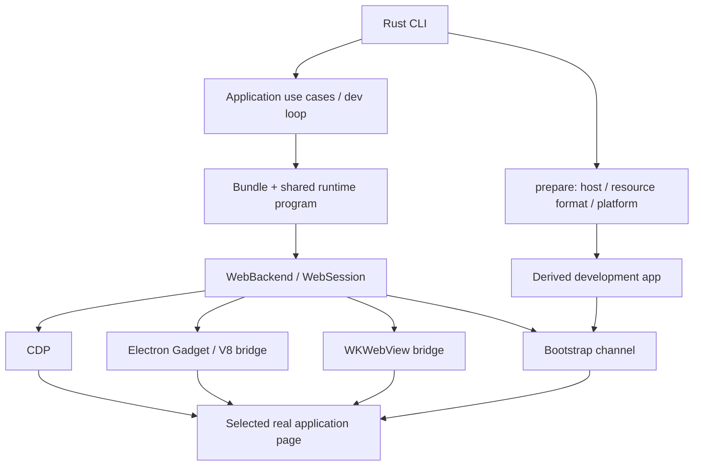

# Injectra

**Retrofitting extensibility into Web-based desktop applications.**
**为基于 Web 的桌面应用补充可复用的扩展能力。**

[English](README.md) · [简体中文](README.zh-CN.md) · [Paper](https://arxiv.org/abs/2611.20713) · [Documentation](docs/README.md) · [Validation matrix](docs/compatibility/current-matrix.md)

Injectra is a **Rust CLI and reusable injection infrastructure** for adding user-provided JavaScript, HTML, and CSS to accessible desktop Web UI contexts. It separates application access from enhancement logic, so payload authors can reuse discovery, target binding, execution, incremental iteration, and diagnostics instead of rebuilding an integration stack for every enhancement.

Use your existing editor and inspect the result **inside the real application**. Injectra provides the access and execution machinery; payload authors remain responsible for selectors, application-specific behavior, rerendering, and side effects.

## Paper and citation

Qin Sun (2026). *Injectra: Retrofitting Extensibility into Web-Based Desktop Applications*. arXiv:2611.20713 [cs.SE].

[Read the paper on arXiv](https://arxiv.org/abs/2611.20713) · [PDF](https://arxiv.org/pdf/2611.20713) · [BibTeX](https://arxiv.org/bibtex/2611.20713) · [DOI](https://doi.org/10.48550/arXiv.2611.20713)

Use **Cite this repository** to copy the paper citation. When reporting results obtained with the software, also record the Git commit or tag you used. [Citation metadata](CITATION.cff)

## What Injectra provides

| Capability | Purpose |
| --- | --- |
| Runtime injection | Discover an accessible running page, select its exact target, and execute an external Bundle. CDP is the default route; optional Electron Gadget and WKWebView backends have separate prerequisites. |
| Lightweight pre-runtime development | Prepare a **derived application copy** with a small Bootstrap entry, then watch external page increments through `prepare` / `dev`. Editing a payload does not require preparing the application again. |
| One shared Web runtime | Load JS/HTML/CSS, replace an existing Bundle with the same ID, and expose owned-node removal and registered cleanup callbacks across Web backends. |
| Explicit execution feedback | Preserve target identity and distinguish `NotExecuted`, `Executed`, and `Unknown`. Uncertain results are not automatically replayed. |
| Replaceable access mechanisms | Separate protocols, host layouts, platform operations, and execution domains; avoid application-brand branches in the shared runtime. |

**Two timings, one execution path:** runtime connects to an already accessible application; pre-runtime prepares an entry before a development instance starts. Pre-runtime page updates then reuse the Web contracts and shared runtime.

## Architecture



The common `core` contains identity, capabilities, errors, and execution certainty without assuming a page, JavaScript, or JSON. The `web` domain owns page execution; the separate `native` domain defines process/address and memory-operation contracts. **General native process-memory access is not implemented.** Platform and host preparation remain outside the domain-independent core. See the [execution-domain boundaries](docs/architecture/boundaries.md) and [code map](docs/architecture/code-map.md).

## Implementation and validation scope

| Area | Current evidence and boundary |
| --- | --- |
| macOS | Apple Silicon only. CDP, Electron Gadget, and WKWebView have recorded fixture/application results under specific versions and access conditions. Intel Mac is outside the current scope. |
| CLI `prepare` / `dev` | macOS Electron CommonJS & ESM (`directory`, `asar`, `nested-asar`, `esm`, `esm-asar`) fixtures, plus QQ main page and Claude local shell; Windows x64 Electron `prepare` / `dev` (`directory` + junction, `asar` + PE `INTEGRITY`, `nested-asar`, `esm`) and `session attach-v8` verified on owned Windows fixtures (`make test-windows`) and representative commercial hosts (Windows Folo `esm-delegate` + PE `INTEGRITY` `prepare`/`dev`, Windows QQ `session attach-v8 --bootstrap-output` → `dev`). Unsupported layouts (such as `.jsc` bytecode) are rejected. |
| Trusted Types / CSP | Declarative DOM mounting (`html_mode: "dom"`) and `PolicyBlocked` error separation verified on Chromium strict Trusted Types fixtures (`trusted-types 'none'`) and commercial hosts (macOS `Devin.app`, Windows `Devin`, Windows `Quark`). |
| Windows | **35 of 38 installed applications obtained page-injection evidence** in the recorded `T-043`/`T-044` campaign (combining native CLI/CDP, Gecko test clients, and experimental Bootstrap/V8 routes; preserved read-only without rewriting historical counts). Subsequent formal Windows CLI commercial proofs are recorded separately in `T-088`. |
| Windows gaps | Youku: startup/Widevine dependency failure. Baidu Netdisk and WeCom: Web entry not obtained in the observed native welcome/login state. FlowUs and Manus were skipped separately by user request. |
| Gecko | Firefox/Thunderbird experiments use separate test clients and host APIs. They are not formal Gecko CLI backends. |
| Linux and native memory | No real-application compatibility claim for Linux; native memory operations remain contract tests using owned buffers. |

These are **version × platform × route × page × validation-contract** results. A DLL, an open port, successful attachment, or a test double is not proof of page execution. Different historical batches are not merged into one experiment; this page does not assert a consolidated macOS success rate.

Start with the [current matrix](docs/compatibility/current-matrix.md), [M-003 commercial CLI validation](docs/validation/m3-commercial-cli.md), [Windows follow-up](docs/validation/windows-retries.md), and [CLI dev acceptance](docs/validation/cli-dev.md).

## Getting started

Tool versions are declared in [mise.toml](mise.toml): Rust **1.93.0** and Node **24.6.0**. Build the Rust CLI with Cargo and a native linker. Node is used for development checks and optional preparation tooling; the compiled CDP CLI does not require Node or Frida.

```sh
git clone https://github.com/sqmw/injectra.git
cd injectra
make build
make run ARGS="--help"
```

Build products default to `${XDG_CACHE_HOME:-$HOME/.cache}/injectra/cargo-target`. `INJECTRA_CACHE_DIR` changes the cache root; `CARGO_TARGET_DIR` can override the build directory. Keep runtime data outside the source tree.

### Runtime: discover, select, apply

The target application must already expose an authorized **loopback** debugging entry. Injectra does not automatically stop user processes or enable an entry on every host.

```sh
make run ARGS="inspect-app --app PATH --port 9222"
make run ARGS="launch-plan --app PATH --port 9222"
make run ARGS="targets --port 9222"
# Inspect title/URL, then use the exact target ID and an external manifest.
make run ARGS="apply --port 9222 --target PAGE_ID --bundle MANIFEST_PATH"
make run ARGS="list --port 9222 --target PAGE_ID"
make run ARGS="eval --port 9222 --target PAGE_ID --expression 'document.title'"
make run ARGS="remove --port 9222 --target PAGE_ID --id BUNDLE_ID"
# Optional Gadget/WKWebView sessions (after make setup-frida and make setup-gadget):
make run ARGS="session launch --app APP_BUNDLE --route webkit"
make run ARGS="session verify --session SESSION_JSON --route webkit"
# Machine callers can pass --machine for single-line JSON envelopes and certainty exit codes (0/2/3/4/5).
make run ARGS="--machine targets --port 9222"
```

For paths with spaces, invoke the built executable directly with properly quoted arguments. A native Windows CDP build can use PowerShell:

```powershell
cargo build --workspace --locked --target-dir "$env:LOCALAPPDATA\Injectra\build"
$Injectra = "$env:LOCALAPPDATA\Injectra\build\debug\injectra.exe"
& $Injectra targets --port 9222
& $Injectra apply --port 9222 --target '<PAGE_ID>' --bundle '<MANIFEST_PATH>'
```

CDP is not the same as the application framework: an Electron/CEF/custom Chromium host must actually expose a usable page endpoint. See [CLI usage](docs/dev.md), [optional Frida backends](docs/frida-backends.md), and [WKWebView conditions](docs/webkit-backend.md).

### Pre-runtime: prepare once, edit external increments

The following workflow targets supported **macOS and Windows Electron** layouts (`directory`, `asar`, `nested-asar`, `esm`, `esm-asar`):

```sh
make setup-preparation
# Set these paths to your original app, a new derived-copy directory,
# an external Bundle manifest, and the artifact_file returned by prepare.
injectra prepare --app "$APP" --output "$DERIVED_DIR" --data-mode isolated
injectra dev --artifact "$ARTIFACT_JSON" --bundle "$BUNDLE_MANIFEST"
```

Here `injectra` denotes the compiled executable. The original installation is retained. `dev` applies the current payload and watches its declared JS/HTML/CSS files; saving in your editor updates the selected real page. Multiple targets require an explicit choice. A page rebuild/closure stops the current update session. Ctrl-C stops the CLI connection without undoing arbitrary JS or automatically quitting the app. Shared data mode requires explicit acceptance for that application. See [dev-mode semantics](docs/architecture/dev-mode.md) and [full commands](docs/dev.md).

## External Bundles and ownership

A manifest v1 specifies a unique `id`, `version: 1`, and relative `js` / `html` / `css` resource paths, with at least one non-empty resource, plus optional `html_mode` (`"inner-html"` default or `"dom"` for declarative safe DOM construction via `createElement`/`createElementNS`/`createTextNode` on Trusted Types / strict CSP pages, reporting policy blocks separately as `PolicyBlocked`). JS is an async function body with optional `context.root` and `context.onCleanup(callback)` support. Paths, file sizes, versions, and IDs are checked before execution. Detailed rules are in the [Bundle contract](docs/dev.md) and [dependency evaluation](docs/architecture/dependency-reduction.md).

**Actual plugins and distributable examples live in the separate `web-ui-plugins` repository.** This repository contains the injector, access implementations, shared runtime, and minimal test fixtures; it does not vendor an application plugin catalog. Use an external manifest path rather than copying plugins into Injectra.


## Development and checks

```sh
make setup-tests       # locked test dependencies in the external cache
make check             # Rust formatting/lint/tests, Web tests, architecture/docs
make test-electron     # isolated Electron fixture, not a user application
make setup-preparation
make test-preparation  # explicit preparation/dev acceptance
```

Real-application tests are **explicit opt-in operations**: they require an authorized entry and precise target. CI runs repository checks and controlled contracts; it does not log into, restart, or manipulate personal applications. Optional native backends have their own dependencies.

## Boundaries

- Payloads are trusted local code, not sandboxed extensions; they execute with the target page's available authority.
- `remove` and registered cleanup cover owned resources, not arbitrary external or persistent side effects. A failed replacement does not automatically restore the previous Bundle.
- `Unknown` is not success and is never automatically replayed. Page navigation/rebuilding requires rediscovery and, when appropriate, explicit reinjection.
- Automatic navigation reinjection, a plugin marketplace, an embedded editor/workbench, arbitrary JS rollback, and application-business adapters are outside the current product scope.

## Contributing, support, and license

Read [CONTRIBUTING.md](CONTRIBUTING.md), [SUPPORT.md](SUPPORT.md), [SECURITY.md](SECURITY.md), and the [Code of Conduct](CODE_OF_CONDUCT.md). Report reproducible engine/access failures separately from payload-specific UI behavior. Contributions to a reference enhancement belong in its own project.

Licensed under [Apache-2.0](LICENSE). Third-party components retain their respective licenses.

[GitHub repository configuration and checks / GitHub协作配置](docs/github.md)
