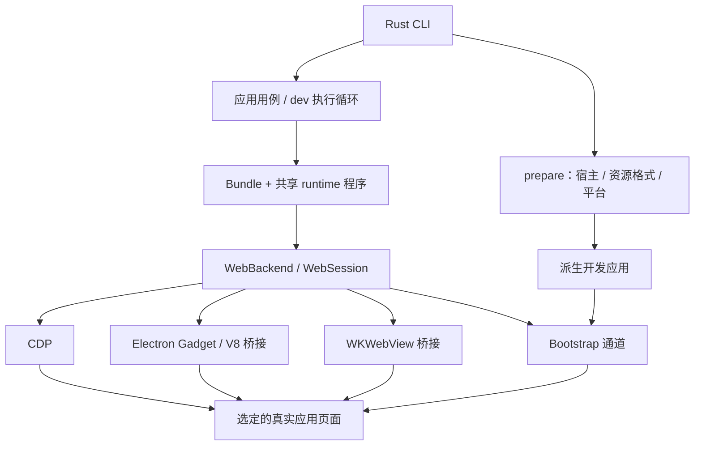

# Injectra

**为基于 Web 的桌面应用补充可复用的扩展能力。**
**Retrofitting extensibility into Web-based desktop applications.**

[English](README.md) · [简体中文](README.zh-CN.md) · [论文](https://arxiv.org/abs/2611.20713) · [文档入口](docs/README.md) · [验证矩阵](docs/compatibility/current-matrix.md)

Injectra 是一套 **Rust CLI 与可复用代码注入基础设施**，将使用者提供的 JavaScript、HTML、CSS 送入可接入的桌面 Web UI 上下文。它把应用接入与增强逻辑分开：不同增强可以复用目标发现、目标绑定、代码执行、增量迭代和诊断反馈，减少重复搭建接入链路的工作。

使用自己的编辑器修改代码，直接在**真实应用窗口**中查看效果。Injectra 负责接入与执行；载荷作者负责选择器、应用业务行为、重渲染覆盖与脚本副作用。

## 论文与引用

Qin Sun (2026). *Injectra: Retrofitting Extensibility into Web-Based Desktop Applications*. arXiv:2611.20713 [cs.SE].

[arXiv 论文页](https://arxiv.org/abs/2611.20713) · [PDF 全文](https://arxiv.org/pdf/2611.20713) · [BibTeX](https://arxiv.org/bibtex/2611.20713) · [DOI](https://doi.org/10.48550/arXiv.2611.20713)

点击仓库侧栏的 **Cite this repository** 即可复制论文引文。报告使用本软件得到的结果时，请同时注明实际使用的 Git 提交或标签。[引用元数据](CITATION.cff)

## 提供什么

| 能力 | 用途 |
| --- | --- |
| runtime 运行期注入 | 发现已运行且可接入的页面，按精确目标加载外部 Bundle。默认 CDP；可选 Electron Gadget、WKWebView 后端分别有自己的前提。 |
| 轻量 pre-runtime 开发 | 对**派生应用副本**准备少量 Bootstrap 引导，通过 `prepare` / `dev` 监听外部页面增量；日常修改载荷无需重新准备应用。 |
| 单一共享 Web runtime | 加载 JS/HTML/CSS、按相同 ID 更新 Bundle，并提供自有节点移除和已登记的清理回调。 |
| 明确的执行反馈 | 保留目标身份，区分 `NotExecuted`、`Executed`、`Unknown`；不自动重放不确定结果。 |
| 可替换的接入实现 | 协议、宿主布局、平台操作和执行域分别隔离；共享 runtime 不按应用品牌分支。 |

**两种时机，同一执行路径：** runtime 连接已有入口；pre-runtime 在开发实例启动前建立入口，后续页面更新继续复用 Web 契约与共享 runtime。

## 架构



通用 `core` 只包含身份、能力、错误与执行确定性，不预设页面、JavaScript 或 JSON。`web` 定义页面执行；独立 `native` 域定义进程、目标地址和内存操作契约。**通用原生进程内存访问尚未实现。** 平台和宿主准备与通用核心分开。详见[执行域边界](docs/architecture/boundaries.md)与[代码地图](docs/architecture/code-map.md)。

## 实现与验证范围

| 方向 | 当前证据与边界 |
| --- | --- |
| macOS | 仅 Apple Silicon。CDP、Electron Gadget、WKWebView 有指定版本与接入条件下的夹具或应用验证；Intel Mac 不在当前范围。 |
| CLI `prepare` / `dev` | macOS Electron CommonJS 与 ESM（目录、ASAR、嵌套 ASAR、ESM 目录、ESM ASAR）夹具，以及 QQ 主页面和 Claude 本地壳；Windows x64 Electron `prepare` / `dev`（目录含包内 Junction、ASAR 含 PE `INTEGRITY`、嵌套 ASAR、ESM）与 `session attach-v8` 已在自有夹具（`make test-windows`）及代表商业宿主（Windows `Folo` `esm-delegate` + PE `INTEGRITY` `prepare`/`dev`、Windows `QQ` `session attach-v8 --bootstrap-output` → `dev`）完成实机验收。未支持布局（如 `.jsc` 字节码）明确拒绝。 |
| Trusted Types / CSP | 声明式安全 DOM 挂载（`html_mode: "dom"`）与 `PolicyBlocked` 策略错误分离已在严格 Trusted Types 夹具（`trusted-types 'none'`）及真实商业宿主（macOS `Devin.app`、Windows `Devin`、Windows `Quark`）完成实机验收。 |
| Windows | 既有历史批次（`T-043`/`T-044`）的 **38 款安装应用中，35 款取得页面注入证据**（包含本机 CLI/CDP、Gecko 测试客户端与早期实验 Bootstrap/V8，历史计数原样保留）。后续以正式 CLI 完成的代表商业宿主回测单列于 `T-088`。 |
| Windows 缺口 | 优酷：启动/Widevine 依赖失败；百度网盘、企业微信：观测到原生欢迎/登录窗口时仍未取得 Web 入口。FlowUs、Manus 按用户要求另行跳过。 |
| Gecko | Firefox/Thunderbird 使用独立测试客户端与宿主 API，尚未成为正式 Gecko CLI 后端。 |
| Linux 与原生内存 | 没有 Linux 真实应用兼容性声明；原生内存操作仅有自有缓冲区合同测试。 |

验证单位是**版本 × 平台 × 路线 × 页面 × 验证合同**。存在 DLL、开放端口、附加成功或测试替身通过，都不等于页面执行成功。不同历史批次不合并成一次实验；本页不宣称一个统一的 macOS 成功率。

证据入口：[当前矩阵](docs/compatibility/current-matrix.md)、[M-003 商业宿主正式 CLI 回测](docs/validation/m3-commercial-cli.md)、[Windows 复验](docs/validation/windows-retries.md)、[CLI dev 验收](docs/validation/cli-dev.md)。

## 快速开始

[mise.toml](mise.toml) 声明 Rust **1.93.0**、Node **24.6.0**；Rust CLI 构建还需要本机链接工具。Node 用于开发检查和可选准备工具；编译后的 CDP CLI 无需 Node 或 Frida。

```sh
git clone https://github.com/sqmw/injectra.git
cd injectra
make build
make run ARGS="--help"
```

默认构建产物位于 `${XDG_CACHE_HOME:-$HOME/.cache}/injectra/cargo-target`；`INJECTRA_CACHE_DIR` 改变缓存根，`CARGO_TARGET_DIR` 可覆盖构建目录。运行数据放仓库外。

### runtime：发现、选择、应用

应用须先开放获授权的**回环调试入口**。工具不自动退出用户进程，也不保证为所有宿主开启入口。替换下列目标 ID 与外部 manifest 路径后运行：

```sh
make run ARGS="inspect-app --app PATH --port 9222"
make run ARGS="launch-plan --app PATH --port 9222"
make run ARGS="targets --port 9222"
make run ARGS="apply --port 9222 --target PAGE_ID --bundle MANIFEST_PATH"
make run ARGS="list --port 9222 --target PAGE_ID"
make run ARGS="eval --port 9222 --target PAGE_ID --expression 'document.title'"
make run ARGS="remove --port 9222 --target PAGE_ID --id BUNDLE_ID"
# 可选 Gadget/WKWebView 会话（需先运行 make setup-frida 与 make setup-gadget）：
make run ARGS="session launch --app APP_BUNDLE --route webkit"
make run ARGS="session verify --session SESSION_JSON --route webkit"
# 机器调用方可使用 --machine 获取单行 JSON 信封及按确定性区分的退出码（0/2/3/4/5）。
make run ARGS="--machine targets --port 9222"
```

路径含空格时，直接调用构建后的二进制并正确引用参数。Windows 原生 CDP 构建可使用 PowerShell：

```powershell
cargo build --workspace --locked --target-dir "$env:LOCALAPPDATA\Injectra\build"
$Injectra = "$env:LOCALAPPDATA\Injectra\build\debug\injectra.exe"
& $Injectra targets --port 9222
& $Injectra apply --port 9222 --target '<PAGE_ID>' --bundle '<MANIFEST_PATH>'
```

CDP 不等于应用框架。Electron、CEF 或定制 Chromium 必须实际提供可执行页面入口。详见[CLI 使用](docs/dev.md)、[可选 Frida 后端](docs/frida-backends.md)、[WKWebView 条件](docs/webkit-backend.md)。

### pre-runtime：准备一次，修改外部增量

当前流程针对已支持的 **macOS 与 Windows Electron** 布局（`directory`、`asar`、`nested-asar`、`esm`、`esm-asar`）：

```sh
make setup-preparation
# APP 为原应用；DERIVED_DIR 为新派生目录；BUNDLE_MANIFEST 为外部载荷。
# ARTIFACT_JSON 使用 prepare 返回的 artifact_file。
injectra prepare --app "$APP" --output "$DERIVED_DIR" --data-mode isolated
injectra dev --artifact "$ARTIFACT_JSON" --bundle "$BUNDLE_MANIFEST"
```

其中 `injectra` 表示构建后的可执行文件。原安装保留；`dev` 首先执行当前载荷，再监听声明的 JS/HTML/CSS，编辑器保存后更新选定真实页面。多页面须明确选择，页面重建或关闭后停止当前更新会话。Ctrl-C 停止 CLI 连接，不撤销任意 JS，也不自动退出 App。共享数据模式需针对该应用明确接受。详见[dev 语义](docs/architecture/dev-mode.md)与[完整命令](docs/dev.md)。

## 外部 Bundle 与插件归属

manifest v1 包含 `version: 1`、唯一 `id` 和相对 `js` / `html` / `css` 资源路径（至少一项资源非空），并支持可选 `html_mode`（默认 `"inner-html"`；在启用 Trusted Types / 严格 CSP 的页面可显式设为 `"dom"`，由纯 Rust 编译为安全 DOM 节点树并以 `createElement`/`createElementNS`/`createTextNode` 挂载，策略拦截会以 `PolicyBlocked` 与用户脚本异常分离报告）。JS 以 async 函数体执行，支持可选 `context.root` 与 `context.onCleanup(callback)`。执行前检查路径、文件大小、版本和 ID，详见[Bundle 合同](docs/dev.md)与[依赖减重评估](docs/architecture/dependency-reduction.md)。

**所有实际插件和可分发示例归独立 `web-ui-plugins` 仓库。** 本库只保存注入器、接入实现、共享 runtime 和最小测试夹具，不内置应用插件目录；请传入外部 manifest，不复制插件进 Injectra。


## 开发与检查

```sh
make setup-tests       # 锁定依赖安装到仓库外缓存
make check             # Rust格式/lint/测试、Web测试、架构与文档
make test-electron     # 独立Electron夹具，不操作用户应用
make setup-preparation
make test-preparation  # 显式准备与dev验收
```

真实应用测试须**显式选择执行**，提供获授权入口和精确目标。CI 运行源码检查及受控合同，不登录、重启或操作个人应用。可选原生后端分别具有额外依赖。

## 责任边界

- 载荷是受信任的本地代码，不是沙箱扩展，权限受目标页面可用能力决定。
- `remove` 与已登记清理只负责拥有的资源，不保证撤销任意外部或持久化副作用；替换失败不自动恢复旧 Bundle。
- `Unknown` 不等于成功，也不自动重放；页面导航/重建后须重新发现并按需显式注入。
- 自动导航重注入、插件市场、内置编辑器/工作台、任意 JS 回滚和应用业务适配不在当前产品范围。

## 贡献、支持与许可

协作前阅读[贡献指南](CONTRIBUTING.md)、[支持说明](SUPPORT.md)、[安全说明](SECURITY.md)及[行为规范](CODE_OF_CONDUCT.md)。请把可复现的引擎/入口失败与载荷专属 UI 行为分开报告；参考增强的修改属于其独立项目。

项目使用 [Apache-2.0](LICENSE)，第三方组件保留各自许可。

[GitHub repository configuration and checks / GitHub协作配置](docs/github.md)
