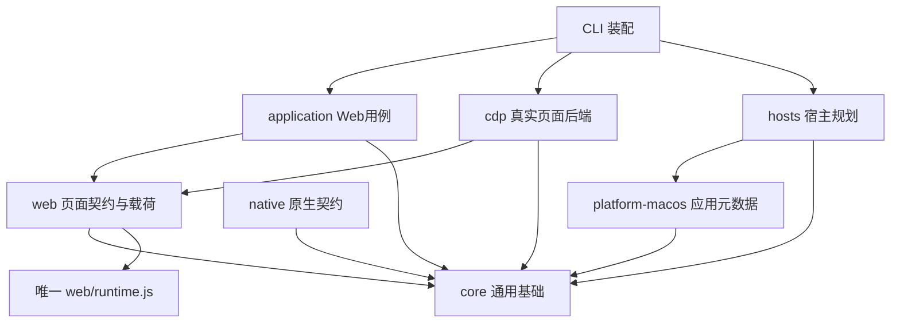

# 可插拔架构

## 产品与长期边界

当前是runtime代码注入工具／核心；产品责任见[需求](../requirements.md)。长期执行域边界已经按[D-004](../DECISIONS.md#d-004)建立，不把页面JS假设写入通用核心。原生部分只有契约及测试内缓冲区，没有真实进程接入或内存操作后端。管理平台、Agent、pre-runtime及自动恢复不属当前交付。

## 模块与依赖

| 模块 | 职责与边界 |
| --- | --- |
| core | BackendId、TargetRef、Capability、错误类别/阶段/执行确定性；无项目crate依赖、无serde_json，无页面/进程操作方法 |
| web | WebTarget、PageContext、WebBackend/WebSession；manifest v1加载与共享程序生成；JSON返回值只属于Web域 |
| application | targets/apply/remove/execute库用例；后端参数注入，连接前检查实例身份，执行前核对会话目标与页面能力 |
| cdp | 唯一真实Web后端；回环端口、精确页面、CDP响应/异常映射；不包含应用名称、载荷加载或原生方法 |
| native | NativeTarget、目标架构/地址、NativeSession及独立MemoryRead/MemoryWrite；受控测试与生产契约分开，无真实后端或Web依赖 |
| platform-macos | inspect_app：.app可执行路径、Framework目录元数据；不识别Electron或生成调试参数 |
| hosts | Electron识别及macOS只读启动规划；依赖平台元数据，不管理用户进程 |
| cli | 解析参数、装配CDP/宿主实现、投影兼容JSON与退出码；不承载注入用例流程 |

公共基础与原生契约可独立构建，不依赖浏览器库、Frida或原生FFI。当前采用静态crate装配；动态插件ABI和调度器不是此架构的必要前提。

## 身份、能力和结果

- BackendId在当前控制进程中每实例唯一；TargetRef为实例身份＋opaque key，不是可持久化/跨控制进程的句柄。Web URL和原生PID均为域内元数据。原生后端以后必须将key绑定到进程实例，不能仅用PID。
- `web.page.evaluate`声明指定页面上下文的执行能力；`js.evaluate`等通用脚本能力不能替代。当前CDP仅发现page目标并使用主页面默认上下文；无frame/isolated-world兼容性承诺。
- core的Result为泛型；JSON、原生字节和写入进度不被强行统一成源码字符串。操作、会话寿命及资源由所属域定义；CLI的短会话不会成为原生域约束。
- Error保存kind、phase、certainty及原始source。NotExecuted表示执行前拒绝；Executed表示已有目标执行证据，不保证效果可撤销；Unknown表示无法确认结果，不自动重放。
- CDP发送或等待响应后失联、超时或无法解析响应保守记为Unknown；目标明确脚本异常为Executed；收到正常求值响应但无法解码返回值同为Executed。
- 原生读写分端口；检查身份、能力和目标地址宽度后才调用后端。短传输以MemoryError报告，保留transferred及已读字节；Unknown进度仅是已确认的下界，可能还有未确认副作用。

完整接口约定与扩展方式见[执行域契约](contracts.md)。

## Web单次注入与兼容性

Web runtime仍只有[一份JS](../../web/runtime.js)，按bundle id记录拥有节点和清理回调。相同ID先清旧再创建/执行新内容；失败不自动恢复旧版；超时/断线不表示页面没有副作用。此既有辅助行为不扩张成任意JS撤销或应用生命周期管理。

页面刷新或重建后由使用者决定再次注入；应用选择器、重渲染覆盖和业务交互不进入core或后端。载荷是受信任代码，页面权限和样式也不是沙箱。

CLI命令、manifest v1、targets的id/title/url、apply/remove返回字段、launch-plan的executable/arguments/note及退出码保留。内部实例身份与错误类型不改变现有成功JSON。

## 演进与验证

2026-11-04已采纳[抖音非CDP阶段性实测](../compatibility/douyin-gadget.md)：独立探针在8.7.0通过Gadget→原V8/Node→Electron页面接口复用共享Web程序。这是实际接入路线证据，尚未成为workspace中的Rust后端；本页模块表的产品实现状态不变，见[D-005](../DECISIONS.md#d-005)。

- 新Web后端实现WebBackend/WebSession并声明页面能力，复用Web载荷与application用例；先证明目标/Promise/返回值/异常合同，再取得真实页面证据。
- 原生后端实现需要的独立端口；原生脚本/模块加载在native域内新增契约。需要进入WebView时新增原生到Web的桥接，实现页面契约，core和CDP无需增加原生方法。
- 新平台提供应用元数据/系统能力，宿主规则独立扩展；当前非macOS的宿主启动规划仍明确拒绝，不伪装支持。
- 测试替身只证明契约；真实支持范围以[验证记录](../validation.md)及[豆包历史证据](../compatibility/doubao.md)为准。历史评估见[迁移前报告](evolution-assessment.md)，其中推迟边界拆分的建议已被D-004及用户批准计划替代。

[代码地图](code-map.md)提供模块与测试导航。
