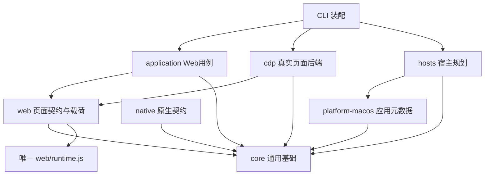

# 可插拔架构

## 产品与长期边界

当前是runtime代码注入工具／核心；本页统一维护架构与执行域契约。产品责任见[需求](../requirements.md)。长期执行域边界已经按[D-004](../DECISIONS.md#d-004)建立，不把页面JS假设写入通用核心。产品native crate只有契约及测试内缓冲区；[references](../../references/README.md)中的真实应用参考脚本不构成产品后端。管理平台、Agent、pre-runtime及自动恢复不属当前交付。

## 模块与依赖

| 模块 | 职责与边界 |
| --- | --- |
| core | BackendId、TargetRef、Capability、错误类别/阶段/执行确定性；无项目crate依赖、无serde_json，无页面/进程操作方法 |
| web | WebTarget、PageContext、WebBackend/WebSession；manifest v1加载与共享程序生成；JSON返回值只属于Web域 |
| application | targets/apply/remove/execute库用例；后端参数注入，连接前检查实例身份，执行前核对会话目标与页面能力 |
| cdp | 唯一真实Web后端；回环端口、精确页面、CDP响应/异常映射；不包含应用名称、载荷加载或原生方法 |
| native | NativeTarget、目标架构/地址、NativeSession及独立MemoryRead/MemoryWrite；受控测试与生产契约分开，无真实后端或Web依赖 |
| platform-macos | inspect_app：.app可执行路径、Framework目录元数据；不识别Electron或生成调试参数 |
| hosts | Electron识别及macOS只读启动规划；依赖平台元数据，不管理用户进程 |
| cli | 解析参数、装配CDP/宿主实现、投影兼容JSON与退出码；不承载注入用例流程 |

公共基础与原生契约可独立构建，不依赖浏览器库、Frida或原生FFI。当前采用静态crate装配；动态插件ABI和调度器不是此架构的必要前提。

## 公共基础

`core`不定义万能Session，也不决定源代码语言、传输协议、输出格式或操作寿命。BackendId由调用方创建后端实例时分配，在控制进程内唯一；克隆身份表示同一个实例。TargetRef中的key仅由其后端解释。跨实例传入同名key会被拒绝，跨控制进程持久句柄尚未定义。

Capability是执行域命名的操作标识，使用精确匹配，不提供隐式fallback。Error的Display保留CLI可读错误，source保存底层原因；代码应检查kind/phase/certainty，不解析Display字符串。

| 确定性 | 含义 | 调用者边界 |
| --- | --- | --- |
| NotExecuted | 本次目标操作未发送/被执行前检查拒绝 | 不代表历史操作没有副作用 |
| Executed | 目标已处理本次执行尝试，或已有传输进度证据 | 可以是解析/运行异常、部分写入或返回值编码失败；不保证载荷所有语句执行或可撤销 |
| Unknown | 请求可能已执行，结果无法确定 | 不自动重放；保留原始原因与已确认进度 |

准备阶段的文件错误/输入错误不会升级成目标执行；后端I/O必须结合实际发送边界构造错误，不能从超时字面推定未执行。core的字符串/文件错误便捷转换只用于准备阶段。

core的Result为泛型；JSON、原生字节和写入进度不被强行统一成源码字符串。操作、会话寿命及资源由所属域定义；CLI的短会话不会成为原生域约束。

CDP发送或等待响应后失联、超时或无法解析响应保守记为Unknown；目标明确脚本异常为Executed；收到正常求值响应但无法解码返回值同为Executed。

## Web执行域

- WebTarget具有TargetRef、title/url和PageContext。当前上下文是MainFrame；仅作页面目标，不包含worker或原生插桩环境。
- WebBackend提供id/targets/connect；connect只能接受其本实例TargetRef，并返回绑定该目标的WebSession。
- WebSession提供target/capabilities/evaluate_page；页面求值等待Promise、以JSON值返回，脚本异常必须保留。某个JS引擎可执行脚本并不足以声明`web.page.evaluate`。
- application公开targets/apply/remove/execute；后端由调用者注入，不导入具体适配。apply保持manifest v1的目录/大小校验和原有共享程序生成；execute核对后端身份、会话目标与页面能力。
- CLI在单次命令边界将显式端口和原target ID转换为内部TargetRef；输出投影回原id/title/url，不暴露实例ID。默认命令仍只装配CDP。

当前CDP仅发现page目标并使用主页面默认上下文；不声明frame/isolated-world兼容性。`js.evaluate`等通用脚本能力不能替代页面能力。

## 原生执行域

- NativeTarget持有TargetRef、pid及TargetArchitecture；PID是元数据，未来真实后端必须验证进程实例身份。架构包含名称、地址位宽和字节序，不从控制机推断。
- TargetAddress明确表示目标地址（u64），不是宿主指针；位宽合同目前为1..64位，区间检查使用更宽算术避免地址溢出。未来更宽地址需版本化扩展此域，不改变Web或core。
- NativeSession只表达目标和声明能力，由调用方拥有资源寿命。MemoryRead、MemoryWrite为独立端口，可以用trait对象传入受检用例，读后端无需提供假写入方法。
- `read_memory`/`write_memory`为受检入口：核对目标引用、能力及目标地址范围后，调用域端口一次；请求长度与返回长度不等时报告错误，不伪报完整成功。
- MemoryError携带core Error、已确认transferred和读取失败时的read_data。Unknown的transferred只证明该部分已确认，不能用它推断其余字节没有变化。
- 端口实现是受信任的适配代码；直接调用底层read/write不会经过用例校验。未来宿主权限和进程保护的核验仍属于真实后端，不由接口声明替代。

只有`#[cfg(test)]`下的BufferSession使用本地Vec缓冲区。当前native crate及默认CLI内不存在真实进程访问、地址解引用、Frida依赖、unsafe或可对外返回模拟成功的CLI命令。原生脚本、模块加载及持续事件接口以后在native域扩展，不强制转换为页面JS或JSON。

## 平台与宿主

platform-macos::inspect_app返回通用的macOS应用包元数据：规范化可执行文件、Framework目录名称。hosts::electron使用这些元数据识别标准Electron并生成既有LaunchPlan。非macOS仍明确拒绝当前规划；计划不启动/重启/结束用户应用。

## 验收句柄

- application合同：同一Bundle送到不同测试后端时生成程序相同；错误目标/缺页面能力不执行；Unknown与source不丢失且只调用一次。
- 原生合同：无URL目标、只读端口、32/64位地址边界、读写/部分进度及Unknown无重放；只证明架构。
- CDP传输合同：地址限制、响应关联、脚本失败/编码失败、协议错误与发送后失联的确定性。
- 真实Electron fixture：从CLI验证页面发现、实际CSS/HTML/JS效果、更新/清理和宿主规划；不是任意WebKit/原生支持证据。

## Web单次注入与兼容性

Web runtime仍只有[一份JS](../../web/runtime.js)，按bundle id记录拥有节点和清理回调。相同ID先清旧再创建/执行新内容；失败不自动恢复旧版；超时/断线不表示页面没有副作用。此既有辅助行为不扩张成任意JS撤销或应用生命周期管理。

页面刷新或重建后由使用者决定再次注入；应用选择器、重渲染覆盖和业务交互不进入core或后端。载荷是受信任代码，页面权限和样式也不是沙箱。

CLI命令、manifest v1、targets的id/title/url、apply/remove返回字段、launch-plan的executable/arguments/note及退出码保留。内部实例身份与错误类型不改变现有成功JSON。

## 演进与验证

2026-11-04已采纳[抖音非CDP阶段性实测](../compatibility/douyin-gadget.md)：独立探针在8.7.0通过Gadget→原V8/Node→Electron页面接口复用共享Web程序。这是实际接入路线证据，尚未成为workspace中的Rust后端；本页模块表的产品实现状态不变，见[D-005](../DECISIONS.md#d-005)。

- 新Web后端实现WebBackend/WebSession并声明页面能力，复用Web载荷与application用例；先证明目标/Promise/返回值/异常合同，再取得真实页面证据。
- 原生后端实现需要的独立端口；原生脚本/模块加载在native域内新增契约。需要进入WebView时新增原生到Web的桥接，实现页面契约，core和CDP无需增加原生方法。
- 新平台提供应用元数据/系统能力，宿主规则独立扩展；当前非macOS的宿主启动规划仍明确拒绝，不伪装支持。
- 测试替身只证明契约；真实支持范围以[验证记录](../validation.md)及[豆包历史证据](../compatibility/doubao.md)为准。

[代码地图](code-map.md)提供模块与测试导航。
