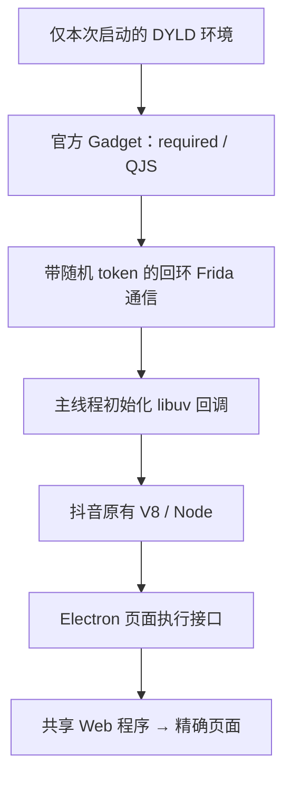

# 抖音非 CDP 注入：阶段性成功

2026-11-04；[T-012](../TODO.md#t-012)；依据独立探针`622fe2e94e10164a083c36e34ff1ae3fdfedbc99`及仓库外原始结果归档。本轮采纳已有结论，没有重新操作应用。

## 已确认结果

**抖音8.7.0真实精选页面的非CDP注入成功。** 页面为`https://www.douyin.com/jingxuan`，类型browserView、主frame。独立面板可见；通过原生UI点击后，页面读回计数0→1。用户随后明确认可“这里是成功了”，要求作为阶段性成果提交main；这不等于用户亲自逐项复核13项检查。

运行环境：macOS26.5.1 arm64、Frida/Gadget17.25.2、Node22.15.1、Electron36.4.0-rs.33.release.pgo.0、V813.6.233.8-electron.0、Chromium136.0.7103.59。

独立受控run的13项全部通过，覆盖点击读回、计算样式、无CDP入口/附加debugger、另一真实页面未注入、Promise、原始页面异常、Promise拒绝、目标URL拒绝、超时Unknown及无重放、同ID更新、移除、最终重注入。逐项结果与源码身份见[脱敏证据](douyin-gadget-evidence.json)。

**产品状态：当前main的Rust CLI仍只装配CDP后端。** 此次成功来自主仓库外的真实应用探针，复用了现有`injectra-web::Bundle::load/apply/remove`与唯一Web runtime，没有在main交付Frida Rust后端或自动启动功能。采纳决策见[D-005](../DECISIONS.md#d-005)。

## 成功路线与前提

- 这是启动加载代理后进行runtime页面注入；需要受控启动，不等于能够附加任意已运行进程。
- 依赖目标已有的DYLD环境变量、库验证相关权限，以及版本匹配的libuv/V8导出和ABI；不承诺其他应用具备相同条件。
- `code_signing=required`用于遵守目标代码签名限制；本次未使用Interceptor。初始optional模式被系统以CODESIGNING/Invalid Page终止，不能据此认定是抖音主动反Frida。
- 抖音声明`LSMultipleInstancesProhibited=true`。经用户明确批准，通过正常菜单退出原实例后才继续正常启动链路；没有强制杀原用户进程。
- Gadget先等待，核对真实PID、可执行路径与独立home，再清除子进程继承的`DYLD_INSERT_LIBRARIES`并推进。不能把`open`启动器PID当作目标。
- 用精确页面引用及URL核对再执行；页面异步建立时先等待发现，不新造空白页替代真实应用页面。

接入代码不通过CDP：受控检查确认remote-debugging-port/pipe未设置、目标debugger未附加；Frida端口不是浏览器调试端口。

## 版本和历史不能混用

| 阶段 | 结果与适用范围 |
| --- | --- |
| 原7.9.0 CDP排查 | 普通参数未取得入口，保留[原后续报告](macos-cdp-followup.md)及旧统计 |
| 原7.9.0外部Frida attach | 主进程与一个renderer被PermissionDenied拒绝；同环境自有调试进程可附加，独立探针`676ac83` |
| Gadget进程及Node阶段 | required模式取得进程内及原Node回执；不单独计为页面成功 |
| 退出重开后的当前8.7.0 | 取得真实页面、可见面板、点击后读回及13项完整受控结果 |
| 后续重复验证 | 首项读到14，不再满足受控初始值1，按失败保留；计数变化来源未独立追踪，不放宽判据或覆盖完整run |

起始安装包为7.9.0，最终磁盘与运行中的`app.getVersion()`均为8.7.0，同时观察到Electron rs.29→rs.33。没有对版本变化的更新执行链作完整因果追踪。未执行人工写原包、重签名、关闭SIP或修改系统授权的命令，最终厂商签名有效；但**不能声称包字节全程不变，也不能把8.7成功和7.9失败当同版本对照**。

原普查31次尝试、20个完整通过项及T-010/T-011历史结论不回填。本次单列非CDP阶段性证据，不改变既有MVP验收。

## 结果、截图与资源边界

面板可见与点击后的DOM计数读回是两类证据。截图有旧帧，像素计数停留0；页面读回为1，不将PNG说成“已经显示计数1”。电脑随后锁定，没有进一步GUI复验。

原始页面异常在页面内捕获并序列化，避免Electron将其转换为通用错误。明确目标拒绝为NotExecuted；未确认结果的超时为Unknown，不重放。libuv native回调由Script.pin保护，关闭句柄并取得回执后才卸载agent。长期取消、控制端崩溃与任意目标的资源回收仍需产品化验收。

独立home/appData/Chromium profile均已读回核对；未导入原登录数据或操作账号/视频。不保证钥匙串、系统偏好和自发遥测完全隔离。记录截止时保留隔离测试窗口和Gadget供查看，回环连接使用随机token，配置与状态权限0600；本轮归档不改变这些进程状态。

## 代码、依赖与证据恢复

2026-11-04经用户进一步确认，参考源码已归档到main的[软件参考目录](../../references/README.md)，当前入口为[抖音案例](../../references/apps/douyin/gadget-v8/README.md)及[共享Electron/V8桥接](../../references/shared/electron-v8/README.md)。仍未作为产品后端；采纳边界见[D-006](../DECISIONS.md#d-006)。

历史源码仍保留于独立仓库`Injectra--probe--douyin-gadget`，分支`codex/douyin-gadget-probe`，完整提交`622fe2e94e10164a083c36e34ff1ae3fdfedbc99`。原提交内的源文件导航：

| 相对探针根目录 | 职责 |
| --- | --- |
| `launch.py`、`agent/bootstrap.js` | 应用身份、独立目录、等待模式、真实PID和home核对 |
| `agent/v8.js`、`bridge.py` | libuv/V8桥接、Node回执和页面结果封装 |
| `apply_page.py`、`verify_page.py`、`capture_page.py` | 共享载荷、13项检查、自有面板截图 |
| `docs/reproduce.md`、`Makefile` | 依赖、启动条件、复核和恢复入口 |

现在克隆main即可取得参考源码；路径迁移版使用自己的锁定环境和[独立Web程序生成器](../../references/shared/web-program/README.md)，不再要求相邻旧探针作为运行依赖。此版本仅做迁移后的静态/离线检查，历史实机结果继续绑定原提交/run，不能冒充新实机复验。原独立仓库与archive终态不变；正式Rust后端若后续落地，仍须按契约重新实现与验证。

Gadget来自官方17.25.2 release；压缩包SHA-256为`e364bc62c7628d6ad34d7ce04134702f2585875bce9d7abc1552bee21657b568`。这里只保存摘要，二进制、profile、token、原始日志及截图留在[缓存根](../dev.md)下的`probes/P-DY-GADGET-001/`：

- 完整通过：`page-verification-1793763712621902000/result.json`。
- 后续失败：`page-verification-1793764095117105000/result.json`。
- 最终启动与截图：`run-1793762935787972000/`。

完整run的bridge/agent哈希与探针提交一致；验证脚本后来仅改变helper缓存路径配置，哈希不同。已重建该单行旧配置并核对原SHA，具体身份在脱敏证据中保留；不将后续脚本版本冒充原受控run。
